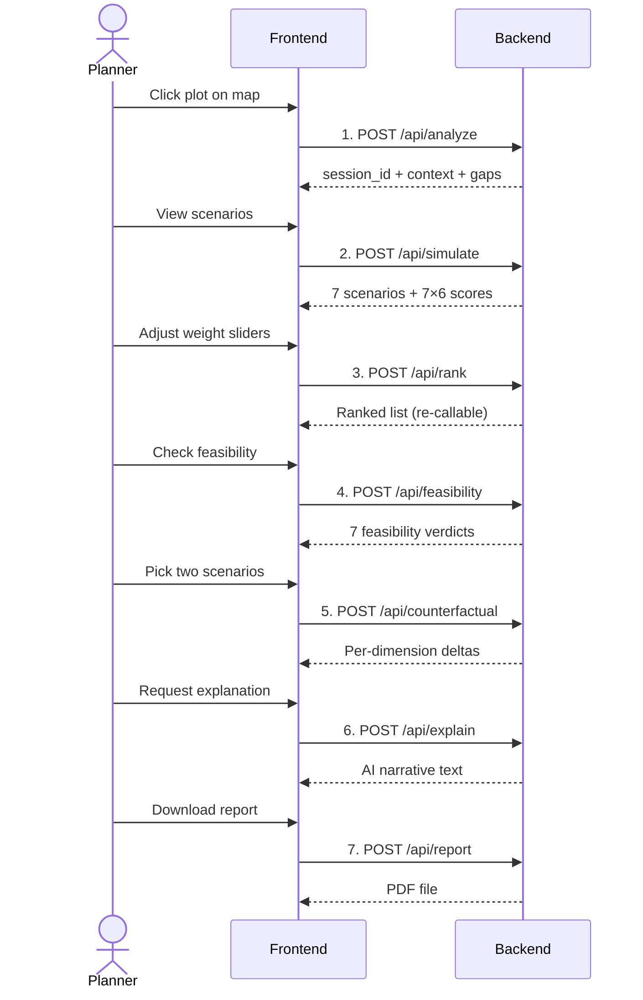
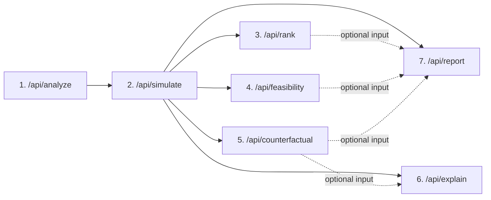
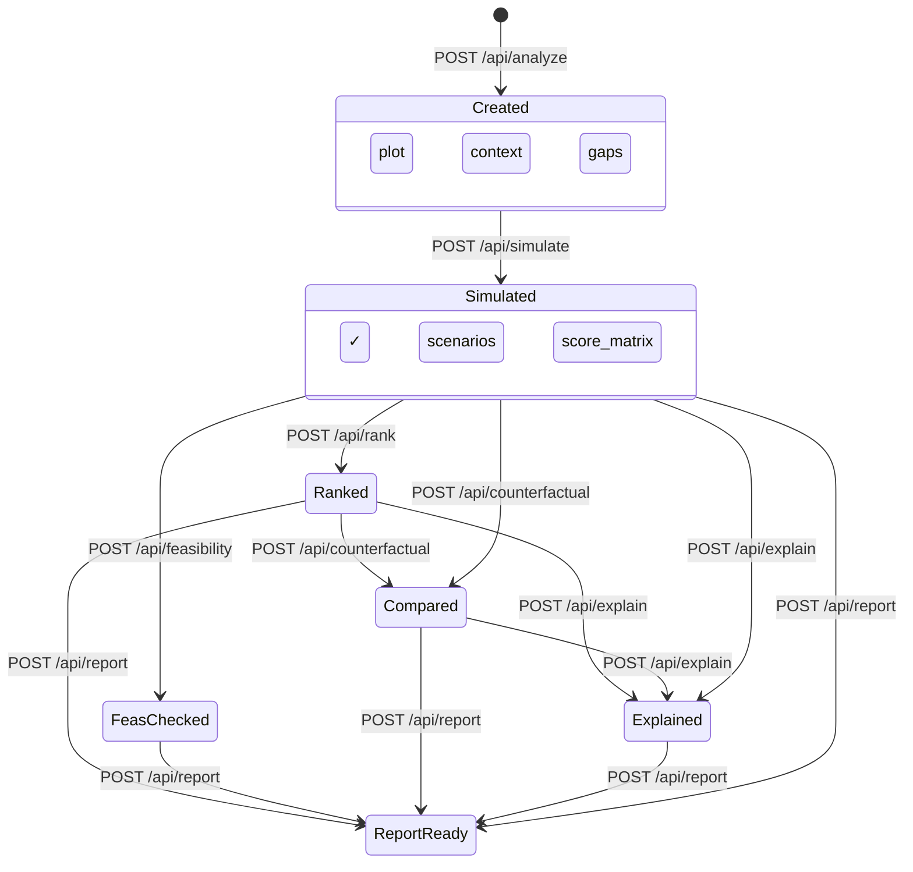

# CivicFork — REST API Contracts

> **Version:** 0.1 · **Date:** 2026-11-05 · **Prerequisite:** Data Contracts v0.1 + Scoring Model v0.1 (locked)

---

## Workflow Sequence



### Endpoint Dependency Graph



> [!NOTE]
> Solid arrows = hard prerequisites (endpoint fails without this data). Dashed arrows = optional enrichment (endpoint works without it but produces richer output if available).

---

## Standard Response Envelope

Every endpoint returns this structure (except `/api/report` which returns raw PDF on success):

```
{
  "success": bool,
  "data": { ... } | null,
  "error": {
    "code": str,
    "message": str,
    "details": { ... } | null
  } | null
}
```

- On success: `success=true`, `data` populated, `error=null`
- On failure: `success=false`, `data=null`, `error` populated
- HTTP status code accompanies every response (200, 400, 404, 422, 500)

---

## Endpoint 1: Analyze Plot

| Property | Value |
|----------|-------|
| **Method** | `POST` |
| **Path** | `/api/analyze` |
| **Purpose** | Accept a plot location, analyse urban context from cached OSM data, identify infrastructure gaps, and create a new session |
| **Creates session** | Yes — generates a new `session_id` |
| **Prerequisite session data** | None (this is the entry point) |
| **Handling services** | OSM Service → Context Analyser → Gap Analyser |
| **Deterministic** | Yes |
| **Mutates SessionData** | Creates new `SessionData` with `plot`, `context`, and `gaps` populated |

### Request Body

| Field | Type | Required | Validation | Tag |
|-------|------|----------|------------|-----|
| `lat` | `float` | Yes | Must be within Mysuru demo bounds (approx 12.20–12.45) | `[supplied]` |
| `lng` | `float` | Yes | Must be within Mysuru demo bounds (approx 76.55–76.75) | `[supplied]` |
| `radius_m` | `int` | No | Default: 2000. Allowed: 500, 1000, 2000, 5000 | `[supplied]` |
| `area_sqm` | `float \| null` | No | If provided, must be > 0 and ≤ 50000 | `[supplied]` |
| `label` | `str \| null` | No | Max 100 chars | `[supplied]` |

### Response Body (200 OK)

```
{
  "success": true,
  "data": {
    "session_id": str,                    // UUID
    "plot": PlotLocation,
    "context_summary": ContextSummary,    // Aggregated stats (see Data Contracts §6)
    "gaps": [InfrastructureGap],          // 7 items, one per category
    "poi_geojson": GeoJSON.FeatureCollection,   // For map overlay rendering
    "landuse_geojson": GeoJSON.FeatureCollection, // For map overlay rendering
    "transport_geojson": GeoJSON.FeatureCollection, // For map overlay rendering
    "bounds": {
      "center": [float, float],          // [lat, lng]
      "radius_m": int
    }
  }
}
```

### Error Responses

| HTTP | Code | Condition |
|------|------|-----------|
| 422 | `VALIDATION_ERROR` | Missing or invalid lat/lng/radius/area |
| 400 | `PLOT_OUT_OF_BOUNDS` | Coordinates outside Mysuru demo area |
| 500 | `OSM_DATA_ERROR` | Cached OSM data failed to load or query |

---

## Endpoint 2: Simulate Scenarios

| Property | Value |
|----------|-------|
| **Method** | `POST` |
| **Path** | `/api/simulate` |
| **Purpose** | Generate 7 development scenarios for the plot, compute deterministic impact scores across 6 dimensions |
| **Requires session_id** | Yes |
| **Prerequisite session data** | `context` and `gaps` must be non-null (i.e., `/api/analyze` must have been called) |
| **Handling services** | Scenario Generator → Impact Simulator |
| **Deterministic** | Yes |
| **Mutates SessionData** | Sets `scenarios` and `score_matrix` |

### Request Body

| Field | Type | Required | Validation | Tag |
|-------|------|----------|------------|-----|
| `session_id` | `str` | Yes | Must be a valid existing session UUID | `[supplied]` |

### Response Body (200 OK)

```
{
  "success": true,
  "data": {
    "scenarios": [Scenario],              // 7 items (see Data Contracts §9)
    "score_matrix": ScoreMatrix,          // 7×6 scores (see Data Contracts §13)
    "default_weights": WeightConfig,      // Equal weights (1/6 each)
    "default_ranking": [RankedScenario]   // Ranking with equal weights
  }
}
```

> [!NOTE]
> The response includes a `default_ranking` computed with equal weights so the frontend can display a ranked list immediately. The user can then adjust weights and call `/api/rank` to re-rank.

### Error Responses

| HTTP | Code | Condition |
|------|------|-----------|
| 422 | `VALIDATION_ERROR` | Missing or invalid session_id |
| 404 | `SESSION_NOT_FOUND` | session_id does not exist |
| 400 | `MISSING_PREREQUISITE` | Session has no context/gaps data (analyze not called first) |
| 500 | `SIMULATION_ERROR` | Scoring engine failed |

---

## Endpoint 3: Rank Scenarios

| Property | Value |
|----------|-------|
| **Method** | `POST` |
| **Path** | `/api/rank` |
| **Purpose** | Apply user-configured municipal priority weights to the score matrix and return a new ranking |
| **Requires session_id** | Yes |
| **Prerequisite session data** | `score_matrix` must be non-null (i.e., `/api/simulate` must have been called) |
| **Handling services** | Ranking Engine |
| **Deterministic** | Yes |
| **Mutates SessionData** | Updates `ranking` and `weights_used` |
| **Re-callable** | Yes — can be called multiple times with different weights |

### Request Body

| Field | Type | Required | Validation | Tag |
|-------|------|----------|------------|-----|
| `session_id` | `str` | Yes | Valid existing session | `[supplied]` |
| `weights` | `WeightConfig` | Yes | All fields ≥ 0; at least one field > 0 | `[supplied]` |

**`WeightConfig` fields:**

| Field | Type | Required | Validation |
|-------|------|----------|------------|
| `traffic` | `float` | Yes | ≥ 0 |
| `cost` | `float` | Yes | ≥ 0 |
| `environmental` | `float` | Yes | ≥ 0 |
| `accessibility` | `float` | Yes | ≥ 0 |
| `gap_improvement` | `float` | Yes | ≥ 0 |
| `social_utility` | `float` | Yes | ≥ 0 |

> Weights do not need to sum to 1.0 — the backend normalises them.

### Response Body (200 OK)

```
{
  "success": true,
  "data": {
    "ranking": [RankedScenario],          // 7 items, sorted rank 1–7
    "weights_applied": WeightConfig       // Normalised weights (sum = 1.0)
  }
}
```

### Error Responses

| HTTP | Code | Condition |
|------|------|-----------|
| 422 | `VALIDATION_ERROR` | Missing fields, negative weights, or all weights zero |
| 404 | `SESSION_NOT_FOUND` | session_id does not exist |
| 400 | `MISSING_PREREQUISITE` | Session has no score_matrix (simulate not called first) |

---

## Endpoint 4: Feasibility Check

| Property | Value |
|----------|-------|
| **Method** | `POST` |
| **Path** | `/api/feasibility` |
| **Purpose** | Run feasibility checks (area, proximity, saturation, zoning) on all 7 scenarios |
| **Requires session_id** | Yes |
| **Prerequisite session data** | `scenarios` and `context` must be non-null |
| **Handling services** | Feasibility Checker |
| **Deterministic** | Yes |
| **Mutates SessionData** | Sets `feasibility` |
| **Priority tier** | P1 |

### Request Body

| Field | Type | Required | Validation | Tag |
|-------|------|----------|------------|-----|
| `session_id` | `str` | Yes | Valid existing session | `[supplied]` |

### Response Body (200 OK)

```
{
  "success": true,
  "data": {
    "verdicts": [FeasibilityVerdict]       // 7 items, one per scenario
  }
}
```

Each `FeasibilityVerdict` contains:

```
{
  "scenario_id": str,
  "feasible": bool,
  "blocker_count": int,
  "warning_count": int,
  "checks": [FeasibilityCheck],
  "blockers": [str],
  "warnings": [str]
}
```

### Error Responses

| HTTP | Code | Condition |
|------|------|-----------|
| 422 | `VALIDATION_ERROR` | Missing or invalid session_id |
| 404 | `SESSION_NOT_FOUND` | session_id does not exist |
| 400 | `MISSING_PREREQUISITE` | Session has no scenarios/context |
| 500 | `FEASIBILITY_ERROR` | Feasibility check logic failed |

---

## Endpoint 5: Counterfactual Comparison

| Property | Value |
|----------|-------|
| **Method** | `POST` |
| **Path** | `/api/counterfactual` |
| **Purpose** | Compute per-dimension deltas between two user-selected scenarios |
| **Requires session_id** | Yes |
| **Prerequisite session data** | `score_matrix` must be non-null |
| **Handling services** | Counterfactual Engine |
| **Deterministic** | Yes |
| **Mutates SessionData** | Sets `counterfactual` (overwrites any previous comparison) |
| **Re-callable** | Yes — can be called with different scenario pairs |

### Request Body

| Field | Type | Required | Validation | Tag |
|-------|------|----------|------------|-----|
| `session_id` | `str` | Yes | Valid existing session | `[supplied]` |
| `scenario_a_id` | `str` | Yes | Must be one of the 7 scenario IDs | `[supplied]` |
| `scenario_b_id` | `str` | Yes | Must be one of the 7 scenario IDs; must differ from `scenario_a_id` | `[supplied]` |

### Response Body (200 OK)

```
{
  "success": true,
  "data": {
    "result": CounterfactualResult
  }
}
```

`CounterfactualResult` contains:

```
{
  "scenario_a_id": str,
  "scenario_a_name": str,
  "scenario_b_id": str,
  "scenario_b_name": str,
  "deltas": [DimensionDelta],            // 6 items
  "a_wins_dimensions": [str],
  "b_wins_dimensions": [str],
  "neutral_dimensions": [str],
  "net_advantage": str,                  // scenario_a_id, scenario_b_id, or "balanced"
  "net_delta": float,
  "headline": str
}
```

### Error Responses

| HTTP | Code | Condition |
|------|------|-----------|
| 422 | `VALIDATION_ERROR` | Missing fields, invalid scenario IDs, or a_id == b_id |
| 404 | `SESSION_NOT_FOUND` | session_id does not exist |
| 400 | `MISSING_PREREQUISITE` | Session has no score_matrix |
| 400 | `INVALID_SCENARIO_ID` | Scenario ID not in the set of 7 |

---

## Endpoint 6: Generate Explanation

| Property | Value |
|----------|-------|
| **Method** | `POST` |
| **Path** | `/api/explain` |
| **Purpose** | Generate AI narrative explaining computed results (context, scores, trade-offs, counterfactual) |
| **Requires session_id** | Yes |
| **Prerequisite session data** | `score_matrix` must be non-null; additional data used if available |
| **Handling services** | Narrative Service → Gemini API |
| **Deterministic** | **No** — Gemini output may vary between calls |
| **Mutates SessionData** | Caches narrative in `narratives` dict keyed by `narrative_type` |
| **Priority tier** | P1 |
| **Graceful degradation** | Returns fallback text if Gemini is unavailable |

### Request Body

| Field | Type | Required | Validation | Tag |
|-------|------|----------|------------|-----|
| `session_id` | `str` | Yes | Valid existing session | `[supplied]` |
| `narrative_type` | `str` | Yes | One of: `context_summary`, `score_explanation`, `counterfactual_explanation`, `full_report` | `[supplied]` |

**Narrative type requirements:**

| narrative_type | Required session data | Optional enrichment |
|----------------|----------------------|---------------------|
| `context_summary` | `context`, `gaps` | — |
| `score_explanation` | `score_matrix` | `ranking`, `feasibility` |
| `counterfactual_explanation` | `score_matrix`, `counterfactual` | `feasibility` |
| `full_report` | `score_matrix` | `ranking`, `feasibility`, `counterfactual` |

### Response Body (200 OK)

```
{
  "success": true,
  "data": {
    "narrative": {
      "narrative_type": str,
      "sections": {                       // Named narrative sections
        "overview": str,
        "key_findings": str,
        "trade_offs": str,
        "recommendation_context": str
      },
      "generated_by": str,               // "gemini" or "fallback"
      "fallback_reason": str | null
    }
  }
}
```

> [!IMPORTANT]
> The `sections` keys vary by `narrative_type`. The frontend should render whatever keys are present. The Narrative Service defines which sections to request from Gemini based on the type.

### Sections by Narrative Type

| narrative_type | Expected sections |
|---------------|-------------------|
| `context_summary` | `overview`, `key_observations` |
| `score_explanation` | `overview`, `key_findings`, `trade_offs` |
| `counterfactual_explanation` | `overview`, `comparison_analysis`, `trade_offs`, `recommendation_context` |
| `full_report` | `executive_summary`, `context_analysis`, `scenario_analysis`, `trade_offs`, `recommendation_context`, `methodology_note` |

### Error Responses

| HTTP | Code | Condition |
|------|------|-----------|
| 422 | `VALIDATION_ERROR` | Missing fields or invalid narrative_type |
| 404 | `SESSION_NOT_FOUND` | session_id does not exist |
| 400 | `MISSING_PREREQUISITE` | Required session data for this narrative_type is missing |
| 200 | *(partial success)* | Gemini failed → `generated_by: "fallback"` with fallback text; **not an error** |

> [!NOTE]
> Gemini failure returns HTTP 200 with degraded content, not an error. The frontend checks `generated_by` to determine if the narrative is AI-generated or a fallback placeholder.

---

## Endpoint 7: Generate PDF Report

| Property | Value |
|----------|-------|
| **Method** | `POST` |
| **Path** | `/api/report` |
| **Purpose** | Assemble all session data + AI narratives into a PDF and return it as a file download |
| **Requires session_id** | Yes |
| **Prerequisite session data** | `score_matrix` must be non-null (hard requirement); `ranking`, `feasibility`, `counterfactual`, `narratives` are included if available |
| **Handling services** | Narrative Service (for report narrative) → Report Generator (ReportLab) |
| **Deterministic** | Data sections: yes. Narrative sections: no (Gemini). |
| **Mutates SessionData** | May cache generated narratives |
| **Priority tier** | P1 |

### Request Body

| Field | Type | Required | Validation | Tag |
|-------|------|----------|------------|-----|
| `session_id` | `str` | Yes | Valid existing session | `[supplied]` |
| `include_narrative` | `bool` | No | Default: `true`. Set `false` to skip Gemini and generate data-only PDF. | `[supplied]` |

### Response (200 OK)

| Header | Value |
|--------|-------|
| `Content-Type` | `application/pdf` |
| `Content-Disposition` | `attachment; filename="civicfork-report-{session_id_short}.pdf"` |

Body: Raw PDF bytes.

> This endpoint does **not** use the standard JSON envelope on success. It returns the PDF file directly. Errors still return JSON.

### PDF Sections Included

| Section | Data source | Included when |
|---------|-------------|---------------|
| Title page | Plot metadata, timestamp | Always |
| Urban context summary | `context_summary` + narrative | Always |
| Infrastructure gap analysis | `gaps` table | Always |
| Scenario overview | `scenarios` table | Always |
| Impact scores | `score_matrix` tables + charts | Always |
| Weighted ranking | `ranking` | If `/api/rank` was called |
| Feasibility assessment | `feasibility` | If `/api/feasibility` was called |
| Counterfactual analysis | `counterfactual` | If `/api/counterfactual` was called |
| AI narrative sections | `narratives` | If `include_narrative=true` and Gemini succeeds |
| Methodology note | Static text | Always |
| Disclaimer | Static text | Always |

### Error Responses

| HTTP | Code | Condition |
|------|------|-----------|
| 422 | `VALIDATION_ERROR` | Missing or invalid session_id |
| 404 | `SESSION_NOT_FOUND` | session_id does not exist |
| 400 | `MISSING_PREREQUISITE` | Session has no score_matrix |
| 500 | `REPORT_GENERATION_ERROR` | ReportLab PDF assembly failed |

---

## Health Check (Non-Workflow)

| Property | Value |
|----------|-------|
| **Method** | `GET` |
| **Path** | `/api/health` |
| **Purpose** | Verify the backend is running and OSM data is loaded |

### Response Body (200 OK)

```
{
  "success": true,
  "data": {
    "status": "healthy",
    "osm_data_loaded": bool,
    "config_loaded": bool,
    "active_sessions": int,
    "demo_area": "mysuru"
  }
}
```

---

## Endpoint Summary Table

| # | Method | Path | Purpose | Prerequisites | Mutates Session | Deterministic | P-tier |
|---|--------|------|---------|--------------|-----------------|---------------|--------|
| 1 | POST | `/api/analyze` | Plot analysis + gap identification | None (creates session) | Creates new | Yes | P0 |
| 2 | POST | `/api/simulate` | Scenario generation + impact scoring | `context`, `gaps` | Sets `scenarios`, `score_matrix` | Yes | P0 |
| 3 | POST | `/api/rank` | Weighted ranking | `score_matrix` | Updates `ranking`, `weights_used` | Yes | P0 |
| 4 | POST | `/api/feasibility` | Feasibility checks | `scenarios`, `context` | Sets `feasibility` | Yes | P1 |
| 5 | POST | `/api/counterfactual` | Pairwise scenario comparison | `score_matrix` | Sets `counterfactual` | Yes | P0 |
| 6 | POST | `/api/explain` | AI narrative generation | Varies by type | Caches in `narratives` | No (Gemini) | P1 |
| 7 | POST | `/api/report` | PDF report generation | `score_matrix` | May cache narratives | Partially | P1 |
| — | GET | `/api/health` | Health check | None | No | Yes | P0 |

---

## Session State Progression



> [!NOTE]
> After `Simulated`, endpoints 3–7 can be called in **any order**. The frontend is free to skip feasibility, skip counterfactual, or go directly to the report. The only hard requirement is the linear chain: analyze → simulate → (everything else).

---

## Design Decisions & Rationale

### Why `/api/analyze` combines context + gaps

Separating them would force the frontend to make two sequential requests before showing anything useful. Since gap analysis depends on context analysis (it's not independently callable), combining them is the simplest correct design. The user sees the full picture — context and gaps — in one response.

### Why `/api/simulate` combines scenario generation + scoring

Scenarios are generated specifically for this plot's context and gaps. There is no use case for generating scenarios without immediately scoring them. Separating them would add an endpoint with no independent value.

### Why `/api/rank` is separate from `/api/simulate`

The user must be able to **re-rank with different weights** without re-running the entire simulation. `/api/rank` is lightweight (matrix multiplication) and re-callable. `/api/simulate` is heavy (full scoring engine). Keeping them separate supports the interactive weight-slider workflow.

### Why `/api/feasibility` is separate

It's P1 priority and optional. The workflow should not require it. A frontend can skip it entirely and still produce a valid report. Keeping it separate respects the priority tiers.

### Why `/api/explain` and `/api/report` are separate

- `/api/explain` returns JSON text for **inline display** in the UI
- `/api/report` returns **PDF bytes** for download
- Different response formats, different purposes, different use cases
- The user may want explanations without generating a full report
- The report may include narratives from a previous `/api/explain` call (cached in session)

### Why no separate `/api/scenarios` endpoint

Scenarios are always generated and scored together in `/api/simulate`. There is no workflow step where the user needs scenario definitions without scores. Adding a separate endpoint would fragment a single atomic operation.

### Why no PATCH or PUT endpoints

All session mutations are append-only — each endpoint adds data to the session. There is no "update" semantic. Re-callable endpoints (`/api/rank`, `/api/counterfactual`) simply overwrite their specific fields. This is simpler than managing partial updates.

---

## Validation Rules Summary

### Global

| Rule | Enforcement |
|------|-------------|
| `session_id` must be a valid UUID string | Pydantic `UUID4` type |
| `session_id` must exist in the session store | Checked in `dependencies.py` |
| Prerequisite data must be non-null | Checked in route handler before calling service |

### Per-field

| Field | Type | Rules |
|-------|------|-------|
| `lat` | `float` | 12.20 ≤ lat ≤ 12.45 (Mysuru bounds) |
| `lng` | `float` | 76.55 ≤ lng ≤ 76.75 (Mysuru bounds) |
| `radius_m` | `int` | Must be one of: 500, 1000, 2000, 5000 |
| `area_sqm` | `float` | > 0, ≤ 50000 |
| `label` | `str` | Max 100 characters |
| `weights.*` | `float` | ≥ 0; sum of all weights > 0 |
| `scenario_a_id` | `str` | Must be in: `park`, `healthcare`, `education`, `parking`, `commercial`, `community_centre`, `public_transport` |
| `scenario_b_id` | `str` | Same set; must differ from `scenario_a_id` |
| `narrative_type` | `str` | Must be in: `context_summary`, `score_explanation`, `counterfactual_explanation`, `full_report` |
| `include_narrative` | `bool` | Optional, defaults to `true` |

### Mysuru Demo Bounds

```
Northwest: 12.45°N, 76.55°E
Southeast: 12.20°N, 76.75°E
```

These are approximate bounds covering the Mysuru city area. Coordinates outside this box trigger `PLOT_OUT_OF_BOUNDS`.
