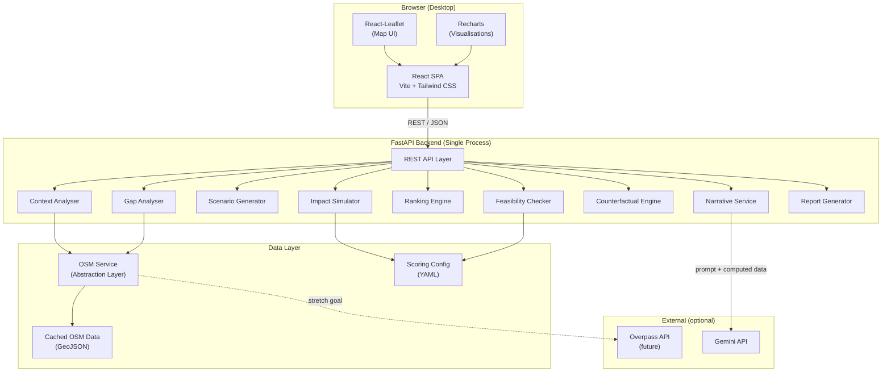
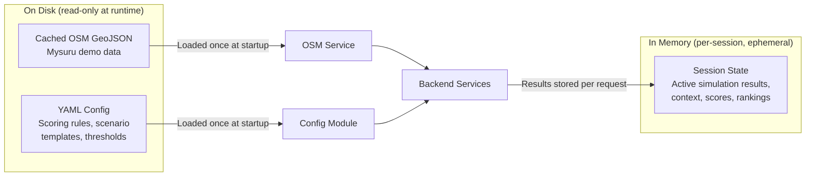
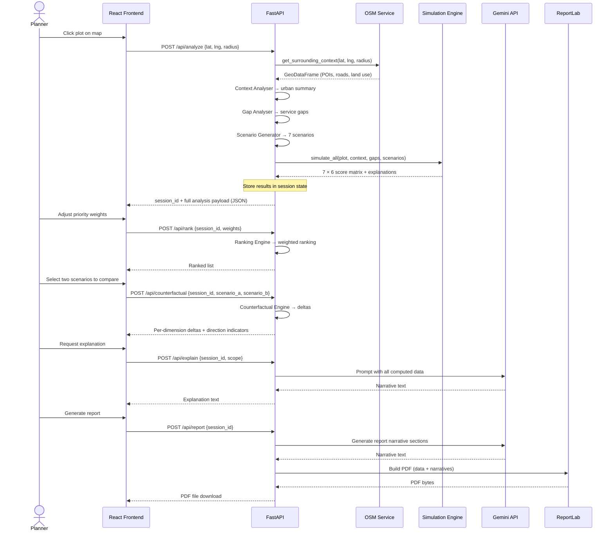
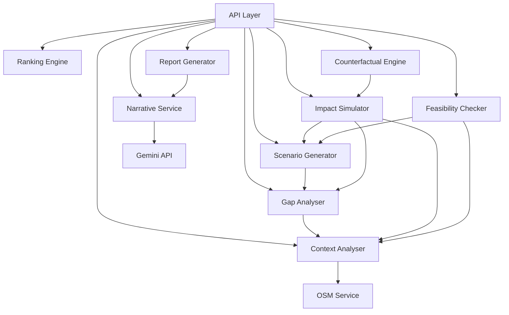
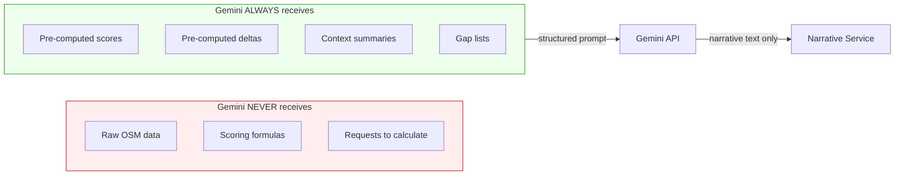
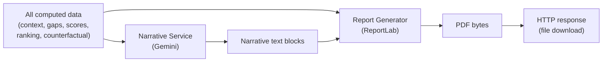
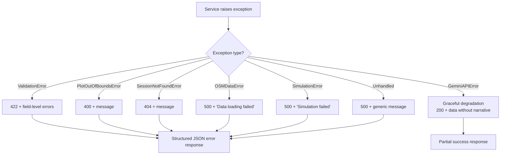

# CivicFork — Technical Architecture

> **Version:** 0.2 (final) · **Date:** 2026-11-05 · **Prerequisite:** Requirements Spec v0.2 (locked)
> **Team size:** 3 · **Build window:** 24 hours · **Demo area:** Mysuru, Karnataka

> [!IMPORTANT]
> All architecture decisions in this document are **locked**. Do not introduce a database, microservices, PostGIS, blockchain, custom ML, or LangChain/LangGraph.

---

## 1. High-Level Architecture

**Two-tier monolith:** React SPA frontend served by Vite dev server, communicating with a single FastAPI backend process over REST. No microservices, no message queues, no separate worker processes, no database.



---

## 2. Locked Architecture Decisions

| # | Decision | Status |
|---|----------|--------|
| A1 | Modular monolithic FastAPI backend (single process) | 🔒 Locked |
| A2 | Direct Python function calls between backend modules (no internal HTTP/RPC) | 🔒 Locked |
| A3 | Seven REST endpoints | 🔒 Locked |
| A4 | Pydantic validation on all API inputs and outputs | 🔒 Locked |
| A5 | `CachedOSMService` for the MVP | 🔒 Locked |
| A6 | Pluggable `OverpassOSMService` interface for future use | 🔒 Locked |
| A7 | Gemini only receives pre-computed results (never raw data, never asked to calculate) | 🔒 Locked |
| A8 | Gemini failure must not break numerical functionality (graceful degradation) | 🔒 Locked |
| A9 | ReportLab for PDF generation | 🔒 Locked |
| A10 | Cross-platform Ubuntu + Windows compatibility | 🔒 Locked |
| A11 | **No database** — zero relational, zero NoSQL, zero embedded DB | 🔒 Locked |
| A12 | Data strategy: cached GeoJSON + YAML config + in-memory state | 🔒 Locked |
| A13 | No server-side persistence | 🔒 Locked |

---

## 3. Data Strategy (Final — No Database)

> [!CAUTION]
> Do not introduce MySQL, SQLite, PostgreSQL, MongoDB, or any other database into the MVP. This decision is final.

### Why no database

CivicFork MVP does not need:
- User accounts or authentication
- Persistent municipal records
- Transaction history
- Historical simulation storage
- Multi-session data sharing

### Three data sources



| Source | Format | Lifetime | Purpose |
|--------|--------|----------|---------|
| **Cached OSM data** | GeoJSON files on disk | Loaded into memory at app startup; read-only | Mysuru POIs, roads, land use, transport, buildings |
| **YAML configuration** | `.yaml` files on disk | Loaded into memory at app startup; read-only | Scoring formulas, thresholds, scaling factors, scenario templates, feasibility constraints |
| **In-memory session state** | Python dicts keyed by session UUID | Lives for the duration of the session; lost on server restart | Current analysis results, scores, rankings, counterfactual data — everything needed to generate the PDF |

### Session state management

- Each analysis run generates a **session UUID** returned to the frontend.
- The frontend includes this UUID in subsequent requests (`/api/rank`, `/api/counterfactual`, `/api/explain`, `/api/report`).
- The backend stores session data in a **Python dict** (`dict[str, SessionData]`).
- No cleanup needed for the MVP. For robustness, an optional TTL-based eviction can be added (P2).
- **Acceptable trade-off:** server restart loses all sessions. This is fine for a hackathon demo.

---

## 4. Frontend → Backend → Data Flow



### Key data flow rules

1. **Frontend sends coordinates, weights, and session ID only.** It never sends raw geospatial data.
2. **Backend returns fully computed results.** Frontend only renders; it never calculates scores.
3. **Gemini receives computed data as input.** It never receives raw data and is never asked to produce numbers.
4. **OSM data flows one way:** disk → OSM Service → consuming services. Frontend never queries OSM.
5. **Session state lives in the backend.** Frontend holds the session UUID; backend holds the data.

---

## 5. Backend Services / Modules

| Module | Responsibility | Key Dependencies |
|--------|---------------|------------------|
| **API Layer** | Request validation, routing, response serialisation, error wrapping | FastAPI, Pydantic |
| **OSM Service** | Abstraction over geospatial data source; loads cached data, returns GeoDataFrames | GeoPandas, Shapely |
| **Context Analyser** | Queries OSM Service for POIs, roads, land use within radius; builds structured urban context summary | OSM Service, Shapely |
| **Gap Analyser** | Compares surrounding infrastructure against service-coverage thresholds; produces gap list with distances | Context Analyser output, NumPy |
| **Scenario Generator** | Produces seven fixed scenario definitions tailored to the plot (area, gaps, context) | YAML config (scenario templates) |
| **Impact Simulator** | Computes deterministic scores for each scenario across six dimensions using rule-based formulas | NumPy, Pandas, YAML config (scoring rules) |
| **Ranking Engine** | Applies user-defined priority weights to score matrix; produces weighted composite + ordered ranking | NumPy |
| **Feasibility Checker** | Validates each scenario against basic constraints (plot area, proximity rules, conflict checks) | Scenario definitions, context, YAML config |
| **Counterfactual Engine** | Takes two scored scenarios, computes per-dimension deltas, direction, and magnitude | NumPy |
| **Narrative Service** | Constructs prompts from computed data, calls Gemini API, returns narrative text | Gemini API client |
| **Report Generator** | Assembles full PDF from computed data + narrative text | ReportLab |

### Module dependency graph



---

## 6. Where Geospatial Processing Happens

**Exclusively in the backend**, inside two modules:

| Module | Geospatial Work | Libraries |
|--------|----------------|-----------|
| **OSM Service** | Loads GeoJSON, builds spatial index, performs radius queries, filters by feature type | GeoPandas, Shapely |
| **Context Analyser** | Buffer geometry around plot, spatial joins to find POIs within radius, distance calculations | Shapely, GeoPandas |

The frontend **only** renders map tiles (from a tile server URL) and plot markers/polygons from GeoJSON coordinates returned by the API. It does **zero** geospatial computation.

---

## 7. Where Simulation and Scoring Happen

**Impact Simulator module** — pure Python with NumPy and Pandas.

```
Inputs:
  - Plot metadata (area, coordinates)
  - Urban context summary (from Context Analyser)
  - Gap list (from Gap Analyser)
  - 7 scenario definitions (from Scenario Generator)
  - Scoring rules (from YAML config)

Processing:
  For each scenario:
    For each dimension (traffic, cost, env, accessibility, gap-improvement, social):
      score = f(plot, context, gaps, scenario_type, rules)
      explanation = { rule_name, input_values, formula, result }

Output:
  - 7 × 6 score matrix (NumPy array)
  - 7 × 6 explanation matrix (list of dicts)
```

### Scoring principles

- Every formula is a **pure function** — no randomness, no external calls.
- Every score ships with its **explanation dict** showing which inputs and formula produced it.
- Scores are **normalised to 0–100** for comparability across dimensions.
- YAML config defines all **magic numbers** (thresholds, weights, scaling factors) — no hardcoded constants in the scoring code.

---

## 8. Where Feasibility Checking Happens

**Feasibility Checker module** — runs after scenario generation, before or alongside simulation.

| Check | Logic | Example |
|-------|-------|---------|
| **Minimum area** | Scenario requires minimum plot area | Healthcare facility needs ≥ 2000 m² |
| **Proximity conflict** | Scenario conflicts with nearby existing facility | Don't build parking next to existing parking garage |
| **Service saturation** | Gap already well-served in radius | Area already has 3 schools within 1 km |
| **Basic zoning compatibility** | Scenario type vs. surrounding land-use pattern | Industrial-adjacent plots may flag for parks |

Output per scenario: `{ feasible: bool, warnings: [str], blockers: [str] }`

Feasibility results are **advisory** — they flag issues but do not remove scenarios from the comparison.

---

## 9. Where Counterfactual Comparison Happens

**Counterfactual Engine module** — pure arithmetic on two scored scenarios.

```
Input:
  - scenario_a_scores: [6 floats]
  - scenario_b_scores: [6 floats]
  - scenario_a_explanations: [6 dicts]
  - scenario_b_explanations: [6 dicts]

Processing:
  For each dimension:
    delta = score_a - score_b
    direction = "better" | "worse" | "neutral"
    magnitude = abs(delta)
    contributing_factors = diff(explanation_a, explanation_b)

Output:
  - 6 deltas with direction and magnitude
  - Per-dimension factor breakdown
  - Summary: which scenario wins on which dimensions
```

No AI involved. Pure deterministic differencing.

---

## 10. Where Gemini Fits



### Gemini is called in exactly two places

| Call site | Purpose | Input | Output |
|-----------|---------|-------|--------|
| **`POST /api/explain`** | Generate plain-language explanation of results, trade-offs, counterfactual | Computed scores, deltas, context summary, gap list | Narrative text (string) |
| **`POST /api/report`** | Generate narrative sections for the PDF report | All computed data for the session | Multiple narrative text blocks |

### Prompt construction

The **Narrative Service** builds structured prompts. Example pattern:

```
You are a municipal planning analyst. The following data has been
computed by a deterministic simulation engine. Do NOT recalculate
or modify any numbers. Your job is to explain these results in
clear, professional language suitable for a municipal report.

[CONTEXT SUMMARY]
...
[SCORES TABLE]
...
[COUNTERFACTUAL DELTAS]
...

Explain the trade-offs between Scenario A and Scenario B.
```

### Graceful degradation

If the Gemini API is unavailable, the system must still function:
- Scores, rankings, and counterfactual deltas display normally.
- Narrative sections show a fallback: *"AI explanation unavailable. See numerical results above."*
- PDF report generates with data tables but without narrative prose.

---

## 11. Where PDF Generation Fits

**Report Generator module** — the final step in the workflow, called only when the user explicitly requests a report.



### PDF structure

| Section | Content source |
|---------|---------------|
| Header / title page | Static template + plot metadata |
| Urban context summary | Context Analyser data + Gemini narrative |
| Infrastructure gap analysis | Gap Analyser data (table) |
| Scenario overview | Scenario definitions (table) |
| Impact scores | Simulator output (table + inline charts via ReportLab) |
| Ranked recommendation | Ranking Engine output |
| Counterfactual analysis | Counterfactual Engine deltas + Gemini narrative |
| Methodology note | Static text explaining deterministic scoring |
| Disclaimer | Static text — decision-support only, not legal advice |

---

## 12. API / Service Boundaries

### REST endpoints

| Method | Path | Purpose | P-tier |
|--------|------|---------|--------|
| `POST` | `/api/analyze` | Full context + gap analysis for a plot; returns session_id | P0 |
| `POST` | `/api/simulate` | Generate scenarios + simulate impacts for a session | P0 |
| `POST` | `/api/rank` | Apply priority weights, return ranked list | P0 |
| `POST` | `/api/feasibility` | Run feasibility checks on scenarios | P1 |
| `POST` | `/api/counterfactual` | Compare two scenarios | P0 |
| `POST` | `/api/explain` | Generate AI narrative for results | P1 |
| `POST` | `/api/report` | Generate and return PDF | P1 |
| `GET`  | `/api/health` | Health check | P0 |

> [!NOTE]
> `/api/config/weights` from v0.1 is removed. Default weight presets are embedded in the YAML config and returned as part of the `/api/simulate` response.

### Request/response conventions

- All requests and responses are JSON (except `/api/report` which returns `application/pdf`).
- Every response wraps in: `{ "success": bool, "data": {...}, "error": {...} | null }`
- Pydantic models validate all inputs and outputs.
- The frontend stores the `session_id` and passes it in subsequent requests.

### Internal service boundaries

Services communicate via **direct Python function calls** — no internal HTTP, no queues, no RPC. Each module exposes a clean function interface and returns typed dataclasses or Pydantic models.

---

## 13. Error Handling

### Error flow



### Principles

| Principle | Implementation |
|-----------|---------------|
| **Never expose internals** | Stack traces logged server-side, never sent to frontend |
| **Gemini failure is non-fatal** | AI narrative degrades gracefully; all numerical features continue |
| **Fail fast on bad input** | Pydantic validation at API boundary before any processing |
| **Log everything** | Python `logging` to stdout; structured format for easy grep |
| **Frontend shows user-friendly messages** | API returns error codes + human-readable messages; frontend maps to UI toast/banner |

### Custom exception hierarchy

```
CivicForkError (base)
├── ValidationError
├── PlotOutOfBoundsError      # Plot outside Mysuru demo area
├── SessionNotFoundError       # Invalid or expired session_id
├── OSMDataError              # Cached data failed to load
├── SimulationError           # Scoring formula failed
├── FeasibilityError          # Feasibility check failed
├── GeminiAPIError            # AI service unavailable/failed
└── ReportGenerationError     # PDF assembly failed
```

---

## 14. Cross-Platform Considerations (Ubuntu + Windows)

| Concern | Approach |
|---------|----------|
| **Python dependencies** | All listed deps (FastAPI, GeoPandas, Shapely, Pandas, NumPy, ReportLab) have wheels for Linux and Windows |
| **File paths** | Use `pathlib.Path` everywhere — never hardcode `/` or `\\` |
| **GeoJSON data files** | Plain text files — no OS-specific format |
| **Line endings** | `.gitattributes` with `* text=auto` |
| **Dev server startup** | Single `uvicorn` command works on both OS; document in README |
| **Frontend tooling** | Vite + npm works identically on both OS |
| **Environment variables** | Use `.env` file with `python-dotenv`; document required vars |
| **No OS-specific shell scripts** | Use `package.json` scripts and Python for any automation |
| **GDAL dependency** | GeoPandas may require GDAL. Use `pip install geopandas` which bundles it via `pyogrio` on modern versions. If issues arise, fall back to pure GeoJSON loading with `json` + Shapely (no GDAL needed). |

---

## 15. Components Removed

| Component | Why removed | Replacement |
|-----------|-------------|-------------|
| **MySQL** | No persistence needed; setup cost too high for 24h; cross-platform friction | YAML config + in-memory session state |
| **Any other database** | Same rationale as MySQL | Same replacement |
| **`/api/config/weights` endpoint** | Unnecessary; weight presets embedded in YAML config | Returned in `/api/simulate` response |

### Explicitly excluded technologies

| Technology | Reason |
|------------|--------|
| Any relational database (MySQL, PostgreSQL, SQLite) | Architecture is database-free by design |
| Any NoSQL database (MongoDB, Redis) | Same |
| PostGIS | No database at all |
| Microservices | Single-process monolith |
| Blockchain | Not relevant |
| Custom ML models | Deterministic rule-based scoring only |
| LangChain / LangGraph | Simple prompt → response; no orchestration framework needed |

---

## Summary: Architecture at a Glance

| Aspect | Decision |
|--------|----------|
| **Topology** | Two-tier monolith (React SPA + FastAPI) |
| **Database** | None — database-free by design |
| **Data sources** | Cached GeoJSON (OSM) + YAML config + in-memory session state |
| **Geospatial processing** | Backend only (GeoPandas + Shapely) |
| **Simulation** | Backend only (NumPy + Pandas), deterministic, rule-based |
| **AI** | Gemini API, server-side only, narrative-only, gracefully degradable |
| **Reports** | ReportLab PDF, generated on-demand |
| **API style** | REST + JSON, 7 endpoints + health check, Pydantic validation |
| **State management** | In-memory session dict; frontend holds session UUID |
| **Deployment** | `uvicorn` + `npm run dev` — two terminal commands |
| **Cross-platform** | Ubuntu + Windows, no OS-specific dependencies |
