# CivicFork — Data Contracts

> **Version:** 0.1 · **Date:** 2026-11-05 · **Prerequisite:** Architecture v0.2 + Folder Structure v0.1 (locked)

---

## Field Annotation Legend

| Tag | Meaning |
|-----|---------|
| `[supplied]` | Provided directly by the user or frontend |
| `[calculated]` | Computed deterministically by Python — reproducible, explainable |
| `[configured]` | Read from YAML config files at startup |
| `[modelled]` | Estimated via rule-based formula — deterministic but approximate |
| `[derived]` | Extracted/transformed from OSM cached data |
| `[generated]` | Produced by Gemini AI — narrative text only, never numerical |

---

## Data Flow Overview

```mermaid
flowchart TD
    PLOT["PlotLocation\n[supplied]"] --> CTX["UrbanContext\n[derived + calculated]"]
    CTX --> GAPS["list of InfrastructureGap\n[calculated]"]
    PLOT --> SCN["list of Scenario\n[configured + modelled]"]
    GAPS --> SCN
    CTX --> SIM["ScoreMatrix\n[calculated]"]
    GAPS --> SIM
    SCN --> SIM
    SIM --> RANK["list of RankedScenario\n[calculated]"]
    WEIGHTS["WeightConfig\n[supplied]"] --> RANK
    SCN --> FEAS["list of FeasibilityVerdict\n[calculated]"]
    CTX --> FEAS
    SIM --> CF["CounterfactualResult\n[calculated]"]
    CTX --> NAR["NarrativeRequest\n[assembled]"]
    GAPS --> NAR
    SIM --> NAR
    RANK --> NAR
    CF --> NAR
    FEAS --> NAR
    NAR --> NARR["NarrativeResponse\n[generated]"]
    CTX --> RPT["ReportData\n[assembled]"]
    GAPS --> RPT
    SIM --> RPT
    RANK --> RPT
    CF --> RPT
    FEAS --> RPT
    NARR --> RPT
```

---

## 1. PlotLocation

**Purpose:** Represents the user-selected land plot for analysis.

**Produced by:** Frontend (user click on map)
**Consumed by:** OSM Service, Context Analyser, Scenario Generator, Impact Simulator

| Field | Type | Tag | Description |
|-------|------|-----|-------------|
| `lat` | `float` | `[supplied]` | Latitude of plot centre |
| `lng` | `float` | `[supplied]` | Longitude of plot centre |
| `radius_m` | `int` | `[supplied]` | Analysis radius in metres (default: 2000) |
| `area_sqm` | `float \| None` | `[supplied]` | Plot area in m² if known; `None` if not provided |
| `label` | `str \| None` | `[supplied]` | Optional user-given label for the plot |

> [!NOTE]
> If `area_sqm` is `None`, the Scenario Generator uses a default area from `scenarios.yaml` for each scenario type. The frontend may allow the user to draw a polygon in P2 scope — for MVP, a click provides a point and optional area input.

---

## 2. POI (Point of Interest)

**Purpose:** A single facility or amenity from cached OSM data within the analysis radius.

**Produced by:** OSM Service (CachedOSMService)
**Consumed by:** Context Analyser, Gap Analyser

| Field | Type | Tag | Description |
|-------|------|-----|-------------|
| `osm_id` | `str` | `[derived]` | OSM feature ID |
| `name` | `str \| None` | `[derived]` | Facility name (may be null in OSM) |
| `category` | `str` | `[derived]` | Normalised category: `healthcare`, `education`, `park`, `commercial`, `community`, `parking`, `transport`, `government`, `religious`, `other` |
| `subcategory` | `str \| None` | `[derived]` | Finer classification: `hospital`, `clinic`, `pharmacy`, `school`, `college`, etc. |
| `lat` | `float` | `[derived]` | Latitude |
| `lng` | `float` | `[derived]` | Longitude |
| `distance_m` | `float` | `[calculated]` | Distance from plot centre (Haversine or Shapely) |
| `tags` | `dict[str, str]` | `[derived]` | Raw OSM tags for reference |

---

## 3. RoadSegment

**Purpose:** A road segment from cached OSM data within the analysis radius.

**Produced by:** OSM Service
**Consumed by:** Context Analyser, Impact Simulator (traffic scoring)

| Field | Type | Tag | Description |
|-------|------|-----|-------------|
| `osm_id` | `str` | `[derived]` | OSM way ID |
| `name` | `str \| None` | `[derived]` | Road name |
| `highway_type` | `str` | `[derived]` | OSM highway value: `primary`, `secondary`, `tertiary`, `residential`, `trunk`, etc. |
| `length_m` | `float` | `[derived]` | Segment length in metres |
| `distance_m` | `float` | `[calculated]` | Nearest distance from plot centre |
| `geometry_coords` | `list[list[float]]` | `[derived]` | `[[lng, lat], ...]` coordinate pairs for rendering |

---

## 4. LandUseZone

**Purpose:** A land-use polygon from cached OSM data within or intersecting the analysis radius.

**Produced by:** OSM Service
**Consumed by:** Context Analyser, Feasibility Checker

| Field | Type | Tag | Description |
|-------|------|-----|-------------|
| `osm_id` | `str` | `[derived]` | OSM way/relation ID |
| `landuse_type` | `str` | `[derived]` | OSM landuse value: `residential`, `commercial`, `industrial`, `retail`, `farmland`, `forest`, `recreation_ground`, etc. |
| `area_sqm` | `float` | `[derived]` | Zone area in m² |
| `distance_m` | `float` | `[calculated]` | Distance from plot centre to zone centroid |
| `overlap_pct` | `float` | `[calculated]` | Percentage of this zone within the analysis radius (0–100) |

---

## 5. TransportStop

**Purpose:** A public transport stop or station from cached OSM data.

**Produced by:** OSM Service
**Consumed by:** Context Analyser, Impact Simulator (accessibility scoring)

| Field | Type | Tag | Description |
|-------|------|-----|-------------|
| `osm_id` | `str` | `[derived]` | OSM node ID |
| `name` | `str \| None` | `[derived]` | Stop/station name |
| `transport_type` | `str` | `[derived]` | `bus_stop`, `railway_station`, `auto_stand`, etc. |
| `lat` | `float` | `[derived]` | Latitude |
| `lng` | `float` | `[derived]` | Longitude |
| `distance_m` | `float` | `[calculated]` | Distance from plot centre |

---

## 6. ContextSummary

**Purpose:** Aggregated statistics computed from raw OSM features — the numerical backbone of the urban context.

**Produced by:** Context Analyser
**Consumed by:** Gap Analyser, Scenario Generator, Impact Simulator, Feasibility Checker, Narrative Service

| Field | Type | Tag | Description |
|-------|------|-----|-------------|
| `total_pois` | `int` | `[calculated]` | Total POIs within radius |
| `poi_counts_by_category` | `dict[str, int]` | `[calculated]` | Count per category (`{"healthcare": 3, "education": 5, ...}`) |
| `poi_density_per_sqkm` | `float` | `[calculated]` | POIs ÷ area of radius circle in km² |
| `road_network_length_m` | `float` | `[calculated]` | Total road length within radius |
| `road_density_m_per_sqkm` | `float` | `[calculated]` | Road length ÷ area in km² |
| `major_road_count` | `int` | `[calculated]` | Count of primary + secondary + trunk roads |
| `nearest_major_road_m` | `float` | `[calculated]` | Distance to nearest major road |
| `dominant_landuse` | `str` | `[calculated]` | Land-use type with largest total area |
| `landuse_distribution` | `dict[str, float]` | `[calculated]` | Percentage breakdown by land-use type (sums to 100) |
| `residential_pct` | `float` | `[calculated]` | % of land area that is residential |
| `commercial_pct` | `float` | `[calculated]` | % of land area that is commercial |
| `green_space_pct` | `float` | `[calculated]` | % of land area that is parks/forest/recreation |
| `industrial_pct` | `float` | `[calculated]` | % of land area that is industrial |
| `transit_stop_count` | `int` | `[calculated]` | Total transit stops within radius |
| `nearest_transit_m` | `float` | `[calculated]` | Distance to nearest transit stop |
| `population_density_estimate` | `float` | `[modelled]` | Estimated population density (people/km²) based on residential area % and building density. **This is a model estimate, not census data.** |
| `building_density_estimate` | `float` | `[modelled]` | Estimated building coverage ratio within radius |

---

## 7. UrbanContext

**Purpose:** Complete urban context package for a selected plot — bundles raw features with computed summary.

**Produced by:** Context Analyser
**Consumed by:** Gap Analyser, Scenario Generator, Impact Simulator, Feasibility Checker, Narrative Service, Report Generator

| Field | Type | Tag | Description |
|-------|------|-----|-------------|
| `plot` | `PlotLocation` | `[supplied]` | The selected plot |
| `pois` | `list[POI]` | `[derived]` | All POIs within radius |
| `roads` | `list[RoadSegment]` | `[derived]` | All road segments within radius |
| `landuse_zones` | `list[LandUseZone]` | `[derived]` | All land-use zones within/overlapping radius |
| `transport_stops` | `list[TransportStop]` | `[derived]` | All transit stops within radius |
| `summary` | `ContextSummary` | `[calculated]` | Aggregated statistics |

---

## 8. InfrastructureGap

**Purpose:** A single identified gap in infrastructure coverage near the selected plot.

**Produced by:** Gap Analyser
**Consumed by:** Scenario Generator, Impact Simulator, Narrative Service, Report Generator

| Field | Type | Tag | Description |
|-------|------|-----|-------------|
| `category` | `str` | `[configured]` | One of: `healthcare`, `education`, `parks`, `transport`, `parking`, `commercial`, `community` |
| `gap_type` | `str` | `[calculated]` | `absent` (none within radius), `insufficient` (below expected count), `distant` (exists but beyond threshold) |
| `nearest_facility_name` | `str \| None` | `[derived]` | Name of the nearest existing facility, if any |
| `nearest_facility_distance_m` | `float \| None` | `[calculated]` | Distance to nearest facility; `None` if absent |
| `coverage_threshold_m` | `float` | `[configured]` | Expected maximum distance for adequate coverage (from YAML) |
| `facilities_in_radius` | `int` | `[calculated]` | Count of matching facilities within analysis radius |
| `expected_facilities` | `int` | `[configured]` | Expected count for this radius based on population estimate |
| `gap_severity` | `float` | `[calculated]` | 0.0 (no gap) to 1.0 (critical gap). Formula: `1 - min(facilities_in_radius / expected_facilities, 1.0)` adjusted by distance factor |
| `description` | `str` | `[calculated]` | Human-readable gap description, e.g. "No healthcare facility within 2 km" |

---

## 9. Scenario

**Purpose:** One of the seven fixed development scenario definitions, tailored to the selected plot.

**Produced by:** Scenario Generator
**Consumed by:** Impact Simulator, Feasibility Checker, Counterfactual Engine, Narrative Service, Report Generator

| Field | Type | Tag | Description |
|-------|------|-----|-------------|
| `id` | `str` | `[configured]` | Unique key: `park`, `healthcare`, `education`, `parking`, `commercial`, `community_centre`, `public_transport` |
| `name` | `str` | `[configured]` | Display name: "Parks / Recreational Space", "Healthcare Facility", etc. |
| `description` | `str` | `[configured]` | Brief description of what would be built |
| `category` | `str` | `[configured]` | Grouping: `green_space`, `public_service`, `infrastructure`, `economic` |
| `required_area_sqm` | `float` | `[configured]` | Minimum area needed for this type |
| `proposed_area_sqm` | `float` | `[calculated]` | Actual area proposed (min of plot area and scenario default) |
| `estimated_cost_inr` | `float` | `[modelled]` | Estimated capital cost. **Rule-based estimate from area × cost-per-sqm factor.** |
| `estimated_annual_operating_cost_inr` | `float` | `[modelled]` | Estimated annual operating cost. **Rule-based estimate.** |
| `estimated_daily_visitors` | `int` | `[modelled]` | Expected daily visitors based on type + population density. **Model estimate.** |
| `estimated_jobs_created` | `int` | `[modelled]` | Expected direct jobs. **Rule-based estimate from type + area.** |
| `estimated_traffic_change_pct` | `float` | `[modelled]` | Expected % change in local traffic volume. **Positive = increase.** |
| `green_space_delta_sqm` | `float` | `[calculated]` | Net change in green space area (positive for parks, negative for paving) |
| `impervious_surface_delta_sqm` | `float` | `[calculated]` | Net change in impervious surface area |
| `addresses_gaps` | `list[str]` | `[calculated]` | Which gap categories this scenario would address |
| `attributes` | `dict[str, any]` | `[configured]` | Scenario-specific attributes from YAML (beds for hospital, classrooms for school, etc.) |

> [!IMPORTANT]
> All `estimated_*` fields are **modelled values** — computed by deterministic formulas using plot area, population density estimate, and per-type factors from `scenarios.yaml`. They are not AI-generated and not real-world predictions.

---

## 10. ScoreExplanation

**Purpose:** Transparent explanation of how a single dimension score was calculated for a single scenario.

**Produced by:** Impact Simulator
**Consumed by:** Counterfactual Engine, Narrative Service, Report Generator, Frontend (expandable detail)

| Field | Type | Tag | Description |
|-------|------|-----|-------------|
| `rule_name` | `str` | `[configured]` | Name of the scoring rule applied |
| `formula_description` | `str` | `[configured]` | Human-readable formula, e.g. "base_score × traffic_factor × road_density_modifier" |
| `input_factors` | `dict[str, float]` | `[calculated]` | Named inputs fed into the formula |
| `intermediate_values` | `dict[str, float]` | `[calculated]` | Named intermediate computation results |
| `raw_result` | `float` | `[calculated]` | Unnormalised formula output |
| `normalised_result` | `float` | `[calculated]` | Final 0–100 score after normalisation |
| `normalisation_range` | `list[float]` | `[configured]` | `[min, max]` used for normalisation |

---

## 11. DimensionScore

**Purpose:** A single score for one dimension of one scenario.

**Produced by:** Impact Simulator
**Consumed by:** Ranking Engine, Counterfactual Engine, Narrative Service, Report Generator

| Field | Type | Tag | Description |
|-------|------|-----|-------------|
| `dimension` | `str` | — | One of: `traffic`, `cost`, `environmental`, `accessibility`, `gap_improvement`, `social_utility` |
| `score` | `float` | `[calculated]` | Normalised score (0–100). **Higher is always better** (cost is inverted so lower cost = higher score) |
| `direction_note` | `str` | — | Clarification: `"Higher = less traffic impact"`, `"Higher = lower cost"`, etc. |
| `explanation` | `ScoreExplanation` | `[calculated]` | Full scoring breakdown |

---

## 12. ScenarioScore

**Purpose:** All six dimension scores for a single scenario.

**Produced by:** Impact Simulator
**Consumed by:** Ranking Engine, Counterfactual Engine, Frontend (scenario card)

| Field | Type | Tag | Description |
|-------|------|-----|-------------|
| `scenario_id` | `str` | — | References `Scenario.id` |
| `scores` | `list[DimensionScore]` | `[calculated]` | Exactly 6 items, one per dimension |
| `unweighted_composite` | `float` | `[calculated]` | Mean of all 6 scores (equal weights) |

---

## 13. ScoreMatrix

**Purpose:** Complete simulation output — all scenarios × all dimensions.

**Produced by:** Impact Simulator
**Consumed by:** Ranking Engine, Counterfactual Engine, Narrative Service, Report Generator, Frontend

| Field | Type | Tag | Description |
|-------|------|-----|-------------|
| `scenario_scores` | `list[ScenarioScore]` | `[calculated]` | Exactly 7 items |
| `dimensions` | `list[str]` | — | `["traffic", "cost", "environmental", "accessibility", "gap_improvement", "social_utility"]` |
| `matrix` | `list[list[float]]` | `[calculated]` | 7×6 array: `matrix[scenario_idx][dimension_idx]` = score (0–100) |
| `scenarios_evaluated` | `int` | — | Always 7 |
| `dimensions_evaluated` | `int` | — | Always 6 |

---

## 14. WeightConfig

**Purpose:** User-defined municipal priority weights for ranking scenarios.

**Produced by:** Frontend (user adjusts sliders) or defaults from config
**Consumed by:** Ranking Engine

| Field | Type | Tag | Description |
|-------|------|-----|-------------|
| `traffic` | `float` | `[supplied]` | Weight for traffic dimension (0.0–1.0) |
| `cost` | `float` | `[supplied]` | Weight for cost dimension |
| `environmental` | `float` | `[supplied]` | Weight for environmental dimension |
| `accessibility` | `float` | `[supplied]` | Weight for accessibility dimension |
| `gap_improvement` | `float` | `[supplied]` | Weight for gap improvement dimension |
| `social_utility` | `float` | `[supplied]` | Weight for social utility dimension |

> [!NOTE]
> Weights are normalised to sum to 1.0 by the Ranking Engine before use. The frontend sends raw slider values; the backend normalises.

---

## 15. RankedScenario

**Purpose:** A single scenario's position in the priority-weighted ranking.

**Produced by:** Ranking Engine
**Consumed by:** Narrative Service, Report Generator, Frontend

| Field | Type | Tag | Description |
|-------|------|-----|-------------|
| `rank` | `int` | `[calculated]` | 1 = best, 7 = worst |
| `scenario_id` | `str` | — | References `Scenario.id` |
| `scenario_name` | `str` | — | Display name |
| `weighted_score` | `float` | `[calculated]` | Weighted composite: Σ(weight_i × score_i) |
| `dimension_contributions` | `dict[str, float]` | `[calculated]` | Per-dimension contribution: `{ "traffic": weight × score, ... }` |
| `score_delta_from_top` | `float` | `[calculated]` | Difference from rank-1 scenario's weighted score |

---

## 16. FeasibilityCheck

**Purpose:** Result of a single feasibility rule applied to a single scenario.

**Produced by:** Feasibility Checker
**Consumed by:** FeasibilityVerdict (parent)

| Field | Type | Tag | Description |
|-------|------|-----|-------------|
| `check_name` | `str` | `[configured]` | Rule name from YAML, e.g. `min_area`, `proximity_conflict`, `service_saturation` |
| `passed` | `bool` | `[calculated]` | Whether the scenario passes this check |
| `severity` | `str` | `[configured]` | `warning` or `blocker` |
| `message` | `str` | `[calculated]` | Human-readable result: "Plot area (1500 m²) is below minimum (2000 m²) for healthcare" |
| `details` | `dict[str, any]` | `[calculated]` | Structured detail: `{"required": 2000, "actual": 1500, "unit": "sqm"}` |

---

## 17. FeasibilityVerdict

**Purpose:** Complete feasibility assessment for a single scenario.

**Produced by:** Feasibility Checker
**Consumed by:** Narrative Service, Report Generator, Frontend (scenario card badge)

| Field | Type | Tag | Description |
|-------|------|-----|-------------|
| `scenario_id` | `str` | — | References `Scenario.id` |
| `feasible` | `bool` | `[calculated]` | `True` if no blockers (warnings OK) |
| `blocker_count` | `int` | `[calculated]` | Number of blocker-severity failures |
| `warning_count` | `int` | `[calculated]` | Number of warning-severity issues |
| `checks` | `list[FeasibilityCheck]` | `[calculated]` | All checks performed |
| `blockers` | `list[str]` | `[calculated]` | Blocker messages (convenience field) |
| `warnings` | `list[str]` | `[calculated]` | Warning messages (convenience field) |

---

## 18. DimensionDelta

**Purpose:** The difference between two scenarios on a single impact dimension.

**Produced by:** Counterfactual Engine
**Consumed by:** CounterfactualResult (parent), Narrative Service

| Field | Type | Tag | Description |
|-------|------|-----|-------------|
| `dimension` | `str` | — | Dimension name |
| `score_a` | `float` | `[calculated]` | Scenario A's score on this dimension |
| `score_b` | `float` | `[calculated]` | Scenario B's score on this dimension |
| `delta` | `float` | `[calculated]` | `score_a - score_b` (positive = A is better) |
| `abs_delta` | `float` | `[calculated]` | `abs(delta)` |
| `direction` | `str` | `[calculated]` | `a_better`, `b_better`, or `neutral` (within ±2 threshold) |
| `magnitude` | `str` | `[calculated]` | `negligible` (<5), `minor` (5–15), `moderate` (15–30), `significant` (30–50), `major` (>50) |
| `explanation_a_summary` | `str` | `[calculated]` | Key factor from Scenario A's explanation for this dimension |
| `explanation_b_summary` | `str` | `[calculated]` | Key factor from Scenario B's explanation for this dimension |

---

## 19. CounterfactualResult

**Purpose:** Complete pairwise comparison between two scenarios.

**Produced by:** Counterfactual Engine
**Consumed by:** Narrative Service, Report Generator, Frontend

| Field | Type | Tag | Description |
|-------|------|-----|-------------|
| `scenario_a_id` | `str` | `[supplied]` | First scenario |
| `scenario_a_name` | `str` | — | Display name |
| `scenario_b_id` | `str` | `[supplied]` | Second scenario |
| `scenario_b_name` | `str` | — | Display name |
| `deltas` | `list[DimensionDelta]` | `[calculated]` | Exactly 6 items |
| `a_wins_dimensions` | `list[str]` | `[calculated]` | Dimensions where A scores better |
| `b_wins_dimensions` | `list[str]` | `[calculated]` | Dimensions where B scores better |
| `neutral_dimensions` | `list[str]` | `[calculated]` | Dimensions within ±2 threshold |
| `net_advantage` | `str` | `[calculated]` | `scenario_a_id`, `scenario_b_id`, or `"balanced"` |
| `net_delta` | `float` | `[calculated]` | Sum of all deltas (positive = A better overall) |
| `headline` | `str` | `[calculated]` | e.g. "Park wins on 4 of 6 dimensions vs Commercial Development" |

---

## 20. NarrativeRequest

**Purpose:** Structured input sent to Gemini via the Narrative Service. Contains **only pre-computed data** — Gemini explains but does not calculate.

**Produced by:** Narrative Service (assembles from session data)
**Consumed by:** Gemini API

| Field | Type | Tag | Description |
|-------|------|-----|-------------|
| `narrative_type` | `str` | — | `context_summary`, `score_explanation`, `counterfactual_explanation`, `full_report` |
| `plot` | `PlotLocation` | `[supplied]` | Plot coordinates and area |
| `context_summary` | `ContextSummary` | `[calculated]` | Aggregated urban stats (not raw POI/road lists) |
| `gaps` | `list[InfrastructureGap]` | `[calculated]` | All identified gaps |
| `scenarios` | `list[Scenario]` | `[configured + modelled]` | The seven scenario definitions |
| `score_matrix` | `ScoreMatrix` | `[calculated]` | Complete 7×6 scoring output |
| `ranking` | `list[RankedScenario] \| None` | `[calculated]` | Weighted ranking (if available) |
| `feasibility` | `list[FeasibilityVerdict] \| None` | `[calculated]` | Feasibility results (if available) |
| `counterfactual` | `CounterfactualResult \| None` | `[calculated]` | Pairwise comparison (if requested) |

> [!CAUTION]
> The Narrative Service must **strip raw geospatial features** (POI lists, road geometries) from the Gemini prompt. Gemini receives only the `ContextSummary` (aggregated stats), not the full `UrbanContext`. This keeps prompts small, focused, and prevents Gemini from re-interpreting raw spatial data.

---

## 21. NarrativeResponse

**Purpose:** AI-generated narrative text returned from Gemini.

**Produced by:** Narrative Service (via Gemini API)
**Consumed by:** Report Generator, Frontend

| Field | Type | Tag | Description |
|-------|------|-----|-------------|
| `narrative_type` | `str` | — | Matches the request type |
| `sections` | `dict[str, str]` | `[generated]` | Named narrative sections: `{"overview": "...", "trade_offs": "...", "recommendation_context": "..."}` |
| `generated_by` | `str` | — | `"gemini"` or `"fallback"` |
| `fallback_reason` | `str \| None` | — | If generated_by is `"fallback"`, explains why: `"API unavailable"`, `"timeout"`, etc. |

---

## 22. ReportData

**Purpose:** Everything needed to generate the PDF — assembled by the API layer from session state.

**Produced by:** API layer (assembles from SessionData)
**Consumed by:** Report Generator (ReportLab)

| Field | Type | Tag | Description |
|-------|------|-----|-------------|
| `report_title` | `str` | — | "CivicFork Urban Policy Impact Assessment" |
| `generated_at` | `str` | — | ISO 8601 timestamp |
| `plot` | `PlotLocation` | `[supplied]` | Plot details |
| `context_summary` | `ContextSummary` | `[calculated]` | Urban context stats |
| `gaps` | `list[InfrastructureGap]` | `[calculated]` | Infrastructure gaps |
| `scenarios` | `list[Scenario]` | `[configured + modelled]` | Seven scenario definitions |
| `score_matrix` | `ScoreMatrix` | `[calculated]` | Full scoring output |
| `ranking` | `list[RankedScenario] \| None` | `[calculated]` | Weighted ranking |
| `weights_used` | `WeightConfig \| None` | `[supplied]` | Weights applied for ranking |
| `feasibility` | `list[FeasibilityVerdict] \| None` | `[calculated]` | Feasibility results |
| `counterfactual` | `CounterfactualResult \| None` | `[calculated]` | Pairwise comparison |
| `narratives` | `NarrativeResponse \| None` | `[generated]` | AI-generated text sections |
| `methodology_note` | `str` | — | Static text explaining deterministic scoring approach |
| `disclaimer` | `str` | — | Static text: decision-support only, not legal/zoning advice |

---

## 23. SessionData

**Purpose:** In-memory container for all data produced during a single analysis session.

**Produced by:** API layer (created on `/api/analyze`, updated on subsequent calls)
**Consumed by:** All subsequent endpoints via session_id lookup

| Field | Type | Tag | Description |
|-------|------|-----|-------------|
| `session_id` | `str` | `[calculated]` | UUID generated on session creation |
| `created_at` | `str` | — | ISO 8601 timestamp |
| `plot` | `PlotLocation` | `[supplied]` | The selected plot |
| `context` | `UrbanContext \| None` | `[derived + calculated]` | Full urban context (set after `/api/analyze`) |
| `gaps` | `list[InfrastructureGap] \| None` | `[calculated]` | Infrastructure gaps (set after `/api/analyze`) |
| `scenarios` | `list[Scenario] \| None` | `[configured + modelled]` | Scenarios (set after `/api/simulate`) |
| `score_matrix` | `ScoreMatrix \| None` | `[calculated]` | Scores (set after `/api/simulate`) |
| `ranking` | `list[RankedScenario] \| None` | `[calculated]` | Ranking (set after `/api/rank`) |
| `weights_used` | `WeightConfig \| None` | `[supplied]` | Last weights applied |
| `feasibility` | `list[FeasibilityVerdict] \| None` | `[calculated]` | Feasibility (set after `/api/feasibility`) |
| `counterfactual` | `CounterfactualResult \| None` | `[calculated]` | Comparison (set after `/api/counterfactual`) |
| `narratives` | `dict[str, NarrativeResponse]` | `[generated]` | Cached narratives keyed by type |

> [!NOTE]
> Fields start as `None` and are populated as the user progresses through the workflow. Each endpoint checks that prerequisite data exists in the session before proceeding (e.g., `/api/rank` requires `score_matrix` to be non-None).

---

## API Request / Response Contracts

### `POST /api/analyze`

**Request:**
| Field | Type | Tag |
|-------|------|-----|
| `lat` | `float` | `[supplied]` |
| `lng` | `float` | `[supplied]` |
| `radius_m` | `int` | `[supplied]` (default: 2000) |
| `area_sqm` | `float \| None` | `[supplied]` (optional) |

**Response:**
| Field | Type |
|-------|------|
| `session_id` | `str` |
| `plot` | `PlotLocation` |
| `context_summary` | `ContextSummary` |
| `gaps` | `list[InfrastructureGap]` |
| `poi_geojson` | GeoJSON FeatureCollection (for map rendering) |
| `landuse_geojson` | GeoJSON FeatureCollection (for map rendering) |

---

### `POST /api/simulate`

**Request:**
| Field | Type | Tag |
|-------|------|-----|
| `session_id` | `str` | `[supplied]` |

**Response:**
| Field | Type |
|-------|------|
| `scenarios` | `list[Scenario]` |
| `score_matrix` | `ScoreMatrix` |
| `default_weights` | `WeightConfig` |

---

### `POST /api/rank`

**Request:**
| Field | Type | Tag |
|-------|------|-----|
| `session_id` | `str` | `[supplied]` |
| `weights` | `WeightConfig` | `[supplied]` |

**Response:**
| Field | Type |
|-------|------|
| `ranking` | `list[RankedScenario]` |
| `weights_applied` | `WeightConfig` (normalised) |

---

### `POST /api/feasibility`

**Request:**
| Field | Type | Tag |
|-------|------|-----|
| `session_id` | `str` | `[supplied]` |

**Response:**
| Field | Type |
|-------|------|
| `verdicts` | `list[FeasibilityVerdict]` |

---

### `POST /api/counterfactual`

**Request:**
| Field | Type | Tag |
|-------|------|-----|
| `session_id` | `str` | `[supplied]` |
| `scenario_a_id` | `str` | `[supplied]` |
| `scenario_b_id` | `str` | `[supplied]` |

**Response:**
| Field | Type |
|-------|------|
| `result` | `CounterfactualResult` |

---

### `POST /api/explain`

**Request:**
| Field | Type | Tag |
|-------|------|-----|
| `session_id` | `str` | `[supplied]` |
| `narrative_type` | `str` | `[supplied]` |

**Response:**
| Field | Type |
|-------|------|
| `narrative` | `NarrativeResponse` |

---

### `POST /api/report`

**Request:**
| Field | Type | Tag |
|-------|------|-----|
| `session_id` | `str` | `[supplied]` |

**Response:**
| Content-Type | Body |
|---|---|
| `application/pdf` | PDF file bytes |

---

## Contract Invariants

| Invariant | Enforcement |
|-----------|-------------|
| Every `[calculated]` field is produced by Python, never by AI | Narrative Service receives only pre-computed data |
| Every `[modelled]` field uses a deterministic formula from YAML config | Same inputs → same outputs, always |
| Score values are always 0–100 | Impact Simulator normalises before returning |
| Higher score always means "better" across all dimensions | Cost and traffic are inverted during scoring |
| Weights always sum to 1.0 when applied | Ranking Engine normalises before computation |
| Session prerequisites are enforced | `/api/rank` fails with 400 if `score_matrix` is None |
| Gemini never sees raw geospatial features | Narrative Service sends `ContextSummary`, not `UrbanContext` |
| All `[generated]` fields have a fallback value | Narrative Service returns fallback text if Gemini is unavailable |
