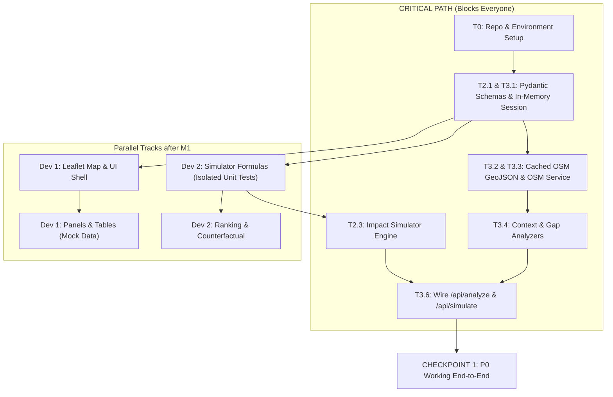

# CivicFork — Phase 0.7: Implementation Plan & Task Decomposition (3 Developers / 24 Hours)

> **Version:** 1.0 · **Date:** 2026-11-05 · **Prerequisites:** All Phases 0.1–0.6 locked  
> **Target:** 24-Hour Hackathon MVP for Mysuru, Karnataka  
> **Team:** 3 Developers (Dev 1: Frontend, Dev 2: Backend Core, Dev 3: Data/Geospatial/Integration)

---

## 1. Developer Ownership Matrix

To minimize file conflicts, each developer has primary ownership over specific sub-trees:

| Developer | Core Role | Primary Directories / Files Owned |
| :--- | :--- | :--- |
| **Dev 1** | **Frontend** | `frontend/src/*`, `frontend/package.json`, `frontend/vite.config.js` |
| **Dev 2** | **Backend Core Simulation** | `backend/app/models/` (co-lead), `backend/app/services/impact_simulator.py`, `backend/app/services/ranking_engine.py`, `backend/app/services/counterfactual_engine.py`, `backend/app/services/feasibility_checker.py`, `backend/config/scoring.yaml`, `backend/config/feasibility.yaml`, `backend/tests/test_impact_simulator.py`, etc. |
| **Dev 3** | **Data, Geospatial & Integration** | `backend/data/mysuru/*`, `backend/app/services/osm_service.py`, `backend/app/services/context_analyzer.py`, `backend/app/services/gap_analyzer.py`, `backend/app/services/scenario_generator.py`, `backend/config/scenarios.yaml`, `backend/app/services/narrative_service.py`, `backend/app/services/report_generator.py`, `backend/app/session.py`, `backend/app/main.py`, `backend/app/api/routes.py` |

---

## 2. Detailed Task Breakdown by Developer

### Dev 1: Frontend (React + Vite + Tailwind + Leaflet + Recharts)
* **T1.1 (Setup):** Initialize Vite + Tailwind + React-Leaflet + Recharts. Create `src/api/client.js` with typed API stubs matching the approved API contracts. Setup mock response fixtures for local UI dev.
* **T1.2 (Map & Plot Selection - P0):** Implement `src/components/map/MapView.jsx` and `PlotMarker.jsx` centered on Mysuru (lat ~12.31, lng ~76.65). Implement click handler emitting lat/lng with bounding validation and a radius circle overlay (default 2000m).
* **T1.3 (Context & Gap Panels - P0):** Implement `src/components/analysis/ContextPanel.jsx` and `GapPanel.jsx` to render `ContextSummary` metrics and the 7 infrastructure gap cards/table.
* **T1.4 (Scenario Cards & Scores Matrix - P0):** Implement `src/components/scenarios/ScenarioCards.jsx` and `ScoreTable.jsx` displaying the 7 scenarios across 6 dimensions with 0–100 color-coded badges and formula explanations.
* **T1.5 (Weights & Ranking List - P0):** Implement `src/components/comparison/WeightSliders.jsx` (6 sliders) and `RankingList.jsx` triggering `POST /api/rank` dynamically on slider change.
* **T1.6 (Counterfactual View - P0):** Implement `src/components/comparison/CounterfactualView.jsx` enabling dropdown comparison of Scenario A vs. B with delta indicators (`+`, `-`, neutral) and magnitude tags.
* **T1.7 (Feasibility & Radar Visualizations - P1):** Implement badges for feasibility blockers/warnings on cards; implement `ScoreChart.jsx` using Recharts Radar/Grouped Bar.
* **T1.8 (Narrative & PDF UI - P1):** Implement `src/components/report/ExplanationPanel.jsx` for AI narrative streaming/fallback, and a "Download PDF Report" action button triggering blob download.

### Dev 2: Backend Core Simulation (Python, NumPy, Pandas)
* **T2.1 (Models Setup - Shared with Dev 3):** Implement Pydantic models in `backend/app/models/requests.py`, `responses.py`, and domain types in `domain.py` strictly according to the Data Contracts document.
* **T2.2 (Configuration Files):** Author `backend/config/scoring.yaml` (base score matrix, modifiers, scaling constants) and `backend/config/feasibility.yaml` (thresholds, conflict radii).
* **T2.3 (Impact Simulator - P0):** Implement `backend/app/services/impact_simulator.py`. Pure deterministic Python/NumPy logic implementing:
  - Base scores from YAML
  - 4 context modifiers per dimension
  - Special Gap Improvement calculation ($G_c \times R_{s,c}$)
  - Normalization and clamping [0, 100]
  - Returning `ScoreMatrix` + `ScoreExplanation` dicts.
* **T2.4 (Ranking Engine - P0):** Implement `backend/app/services/ranking_engine.py`:
  - Weight normalization $\hat{W}_d = W_d / \sum W$
  - Matrix dot product for weighted composite score
  - Tie-breaking logic (Gap score → Alphabetical)
  - Decomposition into dimension contributions and delta from top.
* **T2.5 (Counterfactual Engine - P0):** Implement `backend/app/services/counterfactual_engine.py`:
  - Per-dimension deltas $\delta_d = \text{score}_A - \text{score}_B$
  - Direction classification (`a_better`, `b_better`, `neutral` at $\pm 2$)
  - Magnitude classification (`negligible` to `major`)
  - Dimension win counts and headline formulation.
* **T2.6 (Feasibility Checker - P1):** Implement `backend/app/services/feasibility_checker.py` checking min area, proximity conflict, saturation, and zoning compatibility.
* **T2.7 (Simulation Unit Tests):** Write pytest suites in `tests/test_impact_simulator.py`, `test_ranking_engine.py`, `test_counterfactual.py` using the worked example from Saraswathipuram to verify determinism.

### Dev 3: Data, Geospatial & Integration (GeoPandas, FastAPI, Gemini, ReportLab)
* **T3.1 (Repo Foundation & FastAPI Skeleton):** Set up repo root, `.gitignore`, `.gitattributes`, `backend/requirements.txt`, `app/main.py` with CORS, `app/session.py` in-memory store, and `app/exceptions.py`.
* **T3.2 (OSM Mysuru Dataset Caching - P0):** Curate and bundle static GeoJSON files in `backend/data/mysuru/` (`pois.geojson`, `roads.geojson`, `landuse.geojson`, `transport.geojson`). Ensure valid WGS84 coordinates.
* **T3.3 (OSM Service & Spatial Indexing - P0):** Implement `CachedOSMService` in `osm_service.py` using GeoPandas/Shapely to load GeoJSON at startup and perform radius queries around $(lat, lng)$.
* **T3.4 (Context & Gap Analyzers - P0):**
  - Implement `context_analyzer.py`: radius buffer, spatial join for POI categories, road length density, land-use breakdown, transit counts.
  - Implement `gap_analyzer.py`: calculate coverage and proximity scores, compute $G_c$ severity for the 7 categories.
* **T3.5 (Scenario Generator - P0):** Implement `scenario_generator.py` using `config/scenarios.yaml` to instantiate the 7 concrete `Scenario` instances tailored to the plot.
* **T3.6 (API Routes Integration - P0):** Implement `app/api/routes.py` for `/api/analyze`, `/api/simulate`, `/api/rank`, `/api/counterfactual`, wire FastAPI dependencies and SessionStore.
* **T3.7 (Narrative Service with Gemini - P1):** Implement `narrative_service.py` to format structured prompts from pre-computed metrics and call Gemini API. Enforce graceful fallback on missing API key or timeout.
* **T3.8 (ReportLab PDF Generation - P1):** Implement `report_generator.py` assembling the decision-support PDF (metadata, context tables, score matrix, counterfactual delta summary, disclaimer). Wire `/api/report`.

---

## 3. Dependencies & Critical Path



### Critical Path Alert
* **The blocker of all blockers:** `app/models/` (Pydantic schemas). Must be finalized in Hour 1 so Dev 1 can mock against them while Dev 2 and Dev 3 code against them.
* **Backend handoff blocker:** `ContextAnalyser` output must feed cleanly into `ImpactSimulator`.

---

## 4. Implementation Phasing & 24-Hour Timeline

```
[00:00 - 02:00] PHASE A: Scaffold, Contracts & Data Assets (All Devs)
[02:00 - 08:00] PHASE B: Core P0 Development (Parallel)
[08:00 - 10:00] CHECKPOINT 1: P0 End-to-End Integration (All Devs)
[10:00 - 16:00] PHASE C: P1 Features (Feasibility, Sliders, Gemini, PDF)
[16:00 - 18:00] CHECKPOINT 2: Full Feature Integration (P0 + P1)
[18:00 - 22:00] PHASE D: Polish, Error Handling, Demo Scripting
[22:00 - 24:00] PHASE E: Rehearsal & Freeze (Zero Code Changes)
```

---

## 5. Integration Checkpoints

### Checkpoint 1 (Hour 08–10): P0 Functional Gate
* **Goal:** Verify that a planner can click on Mysuru map $\rightarrow$ see context + gaps $\rightarrow$ see 7 simulated scenarios $\rightarrow$ compare two counterfactually.
* **Acceptance Criteria:**
  1. `POST /api/analyze` returns valid `session_id` and GeoJSON POIs within < 500ms.
  2. `POST /api/simulate` returns 7x6 score matrix with values strictly between 0 and 100.
  3. `POST /api/counterfactual` returns proper delta directions and magnitude strings.
  4. Frontend UI displays these numbers accurately without browser errors.

### Checkpoint 2 (Hour 16–18): Full Feature & Export Gate
* **Goal:** Verify interactive weight slider re-ranking, feasibility warnings, AI narratives, and PDF download.
* **Acceptance Criteria:**
  1. Sliders dynamically update ranks via `POST /api/rank` in real-time.
  2. If Gemini key is empty/invalid, UI cleanly shows deterministic fallback text without error banners.
  3. Clicking "Download Report" produces a readable, formatted PDF document with all tables and scores.

---

## 6. P0 vs. P1 Scope Division

| Component | P0 — Must Work for Demo | P1 — Important (Only After Checkpoint 1) | P2 — Polish / Cut First |
| :--- | :--- | :--- | :--- |
| **Map & Plot** | Mysuru click-to-select, fixed radius circle | Plot area manual input, coordinate search box | Custom polygon boundary drawing |
| **Context & Gaps** | POI count, land-use breakdown, 7 gap severities | Distance to nearest facility text badges | Custom radius selector dropdown (500m–5km) |
| **Scenarios** | Fixed 7 scenarios with generated attributes | Feasibility warnings/blocker flags | Dynamic attribute tweaking |
| **Simulation** | Deterministic 7×6 score matrix & formula explanations | Configurable weight sliders & dynamic re-ranking | Radar chart visualizations (Recharts) |
| **Counterfactual** | Dropdown A vs B comparison with deltas and win-counts | AI-generated counterfactual narrative explanation | Extended 3-way scenario comparison |
| **AI / Narrative** | *None (Fallback text handles explainers)* | Gemini prompt builder for context & trade-offs | Multi-turn chat / Q&A |
| **Reports** | *None* | ReportLab PDF generation with data tables & disclaimer | Custom logo upload, multi-page styling |

---

## 7. Definition of Done (DoD)

* **Backend Service Modules:** Pure functions covered by at least 1 pytest test matching the mathematical specification. Returns exact Pydantic types. No unhandled 500 exceptions on edge cases (e.g., zero POIs).
* **API Endpoints:** Adheres 100% to the approved response envelope `{ success, data, error }`. Validated with FastAPI OpenAPI `/docs`.
* **Frontend Components:** Renders cleanly with zero console warnings. Handles API loading states (spinner) and error states gracefully. Works at standard 1080p desktop resolution.
* **AI Integration:** Works with real API key AND gracefully degrades to structured fallback strings if offline or rate-limited.
* **Cross-Platform:** Works on Ubuntu and Windows without path separator bugs (`pathlib.Path` used universally).

---

## 8. Git & Branching Strategy

To eliminate merge conflicts in a 24-hour hackathon:

```mermaid
gitGraph
   commit id: "Init Repo & Docs"
   branch dev1-frontend
   branch dev2-simulation
   branch dev3-data-api
   checkout dev3-data-api
   commit id: "Models & Routes Skeleton"
   checkout main
   merge dev3-data-api id: "Merge Contracts (Hour 2)"
   checkout dev1-frontend
   merge main
   commit id: "UI Components"
   checkout dev2-simulation
   merge main
   commit id: "Scoring Engine"
   checkout dev3-data-api
   merge main
   commit id: "OSM & Gap Analyzers"
   checkout main
   merge dev2-simulation id: "Checkpoint 1 Integration"
   merge dev3-data-api id: "Checkpoint 1 Backend Done"
   merge dev1-frontend id: "Checkpoint 1 Full P0"
```

### Git Rules
1. **Protected Main:** No direct commits to `main` except during coordinated checkpoint merges.
2. **Feature Branches:**
   - `feat/frontend` (Dev 1)
   - `feat/simulation-core` (Dev 2)
   - `feat/data-api` (Dev 3)
3. **Model & Contract Lock:** Dev 2 and Dev 3 commit `backend/app/models/` together in Hour 1. Once merged to `main`, **models are frozen**. If changes are needed, all 3 must agree.
4. **Endpoint Ownership:** Dev 3 owns `routes.py`. Dev 2 provides service functions; Dev 3 wires them to routes to prevent merge collisions in FastAPI routers.

---

## 9. 24-Hour Prioritization & Emergency Cuts

If behind schedule at Hour 14:

1. **Cut 1 (Drop PDF Generation):** Remove ReportLab PDF export. The demo can rely entirely on the rich interactive dashboard. (Saves 3 hours).
2. **Cut 2 (Drop Live Gemini Integration):** Use hardcoded deterministic template narratives (e.g., *"Scenario A outperforms Scenario B on environmental grounds due to an 85% green space ratio."*). (Saves 2 hours).
3. **Cut 3 (Drop Feasibility Checking):** Remove `feasibility_checker.py` and display all scenarios as viable. (Saves 1.5 hours).
4. **Cut 4 (Drop Radar Charts):** Replace Recharts radar visualizations with standard HTML/Tailwind bar indicators or colored tables. (Saves 2 hours).

> [!CAUTION]
> **NEVER CUT:**
> - Plot selection on the map
> - Deterministic 7×6 score calculation
> - Counterfactual comparison view
> These three form the core thesis of CivicFork.

---

## 10. Recommended Execution Sequence (Hour-by-Hour)

1. **Hour 0–1:** Repo initialization, `.gitignore`, `.gitattributes`, install packages. Dev 2 & Dev 3 pair on `app/models/domain.py`, `requests.py`, and `responses.py`.
2. **Hour 1–2:** Dev 3 commits static Mysuru GeoJSON and basic FastAPI shell. Merge `models` and `data` to `main`. Dev 1 pulls models and sets up mock API fixtures.
3. **Hour 2–5:**
   - Dev 1 builds `MapView` and `ContextPanel` using mock data.
   - Dev 2 writes `impact_simulator.py` and `scoring.yaml` with pytest verification.
   - Dev 3 writes `osm_service.py`, `context_analyzer.py`, and `gap_analyzer.py`.
4. **Hour 5–8:**
   - Dev 1 builds `ScoreTable` and `CounterfactualView`.
   - Dev 2 writes `ranking_engine.py` and `counterfactual_engine.py`.
   - Dev 3 integrates services into `/api/analyze`, `/api/simulate`, `/api/rank`, and `/api/counterfactual`.
5. **Hour 8–10 (CHECKPOINT 1):** Merge all branches into `main`. Test P0 workflow end-to-end on real Mysuru coordinates.
6. **Hour 10–14:**
   - Dev 1 integrates interactive weight sliders and Recharts charts.
   - Dev 2 implements `feasibility_checker.py` and `feasibility.yaml`.
   - Dev 3 implements `narrative_service.py` (Gemini API with fallback).
7. **Hour 14–17:**
   - Dev 3 implements `report_generator.py` (ReportLab PDF).
   - Dev 1 hooks up Feasibility badges, AI narrative panel, and PDF download button.
   - Dev 2 conducts boundary checks and edge case tests.
8. **Hour 17–19 (CHECKPOINT 2):** Full P0 + P1 integration test. Verify PDF export and Gemini fallback behavior.
9. **Hour 19–22:** Bug fixing, cross-platform verification (test on Ubuntu & Windows), visual polish, responsive styling adjustments.
10. **Hour 22–24:** **Code Freeze.** Rehearse the 3-minute demo flow (Saraswathipuram plot selection $\rightarrow$ Park vs Commercial counterfactual $\rightarrow$ Decision support report export).
