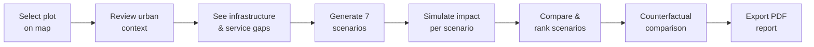

# CivicFork — Requirements Specification

> **Version:** 0.2 · **Date:** 2026-11-05 · **Scope:** 24-hour hackathon MVP
> **Demo area:** Mysuru, Karnataka, India

---

## 1. Core Problem

Municipal planners lack a quick, structured way to evaluate what should be built on a given plot of land. Decisions are made with incomplete context, no systematic comparison of alternatives, and no counterfactual reasoning. CivicFork gives planners a deterministic, explainable simulation to compare development scenarios side-by-side before committing resources.

## 2. Target User

**Municipal urban planner** — a city/town government employee responsible for land-use decisions, zoning recommendations, or infrastructure planning. They are not data scientists; they need clear, visual, evidence-based outputs.

## 3. Main User Workflow

| Step | Description |
|------|-------------|
| **1. Select plot** | Click or search for a land parcel on the map within the Mysuru demo area. |
| **2. Analyse context** | System displays surrounding land use, demographics, and existing services within a configurable radius. |
| **3. Identify gaps** | System highlights nearby infrastructure and flags service gaps (e.g., no healthcare facility within 2 km). |
| **4. Generate scenarios** | System produces seven fixed development scenarios for the selected plot. |
| **5. Simulate impact** | For each scenario, Python computes deterministic scores across six impact dimensions. |
| **6. Compare scenarios** | Planner sets municipal priority weights; scenarios are ranked accordingly. |
| **7. Counterfactual comparison** | Planner picks any two scenarios and views a structured "what-if" differential. |
| **8. Generate report** | System exports a PDF decision-support report via ReportLab. |

## 4. Core Features

| # | Feature | Priority |
|---|---------|----------|
| F1 | Interactive map with plot selection | P0 |
| F2 | Urban context analysis (surrounding land use) | P0 |
| F3 | Infrastructure & service-gap identification | P0 |
| F4 | Fixed seven-scenario generation | P0 |
| F5 | Deterministic impact simulation (six dimensions) | P0 |
| F6 | Scoring & ranking of scenarios | P0 |
| F7 | Pairwise counterfactual comparison | P0 |
| F8 | Configurable municipal priority weights | P1 |
| F9 | Feasibility checks per scenario | P1 |
| F10 | AI-generated narrative explanations | P1 |
| F11 | Dashboard visualisations (charts, radar plots) | P1 |
| F12 | PDF report generation (ReportLab) | P1 (include if P0 is stable) |
| F13 | Advanced UI polish | P2 |
| F14 | Additional / decorative visualisations | P2 |

## 5. Required Inputs

| Input | Source | Notes |
|-------|--------|-------|
| **Plot location** | User click on map / search | Coordinates + approximate area within Mysuru demo bounds |
| **Context radius** | User (default: 2 km) | Configurable: 1 km, 2 km, 5 km |
| **Surrounding land-use data** | Cached OSM data for Mysuru | Static dataset bundled with the app; abstraction layer allows live Overpass queries later |
| **Municipal priority weights** | User-configured sliders (P1) | Weights for the six impact dimensions; equal weights as default |
| **Counterfactual pair** | User selection | Two scenarios to compare |

## 6. Required Outputs

| Output | Format |
|--------|--------|
| **Urban context summary** | Map overlay + structured text panel |
| **Service-gap list** | Table: gap type, nearest existing facility, distance |
| **Scenario impact scores** | Table/chart: 7 scenarios × 6 dimensions, all deterministic |
| **Ranked scenario list** | Ordered by weighted composite score |
| **Counterfactual differential** | Side-by-side comparison showing per-dimension deltas between two scenarios |
| **Decision-support report** | PDF generated via ReportLab |

## 7. Impact Dimensions

Each scenario is scored across these six dimensions. Scores are **deterministic and rule-based** — derived from plot context and scenario type via transparent Python formulas.

| Dimension | What it captures |
|-----------|-----------------|
| **Traffic** | Expected change in local traffic volume and congestion |
| **Cost** | Estimated relative capital + operational cost |
| **Environmental impact** | Green-space change, emissions, impervious surface delta |
| **Accessibility** | Walking/transit access for surrounding residents |
| **Infrastructure-gap improvement** | How much the scenario closes identified service gaps |
| **Public/social utility** | Community benefit: jobs, health access, recreation, social cohesion |

## 8. AI / LLM Usage Boundary

> [!IMPORTANT]
> This boundary is a hard architectural constraint, not a preference.

### AI MAY do (narrative only)

- Explain calculated results in plain language
- Summarise the urban context around a selected plot
- Explain trade-offs between two scenarios in the counterfactual view
- Generate narrative sections of the PDF report

### AI MUST NOT do

- Calculate or invent scores
- Calculate or invent rankings
- Calculate or invent traffic values
- Calculate or invent cost values
- Calculate or invent gap scores
- Calculate or invent counterfactual differences
- Produce any number that feeds into the simulation or scoring pipeline

### Ownership

| Responsibility | Owner |
|----------------|-------|
| All numerical simulation, scoring, ranking, counterfactual deltas | **Python (deterministic engine)** |
| All narrative explanation, summarisation, trade-off prose | **AI/LLM** |

## 9. What CivicFork MUST Do

1. Use **deterministic, rule-based simulation** — identical inputs always produce identical outputs.
2. Make every score **explainable** — the user can see which rules and context factors produced each number.
3. Keep all seven scenario types **fixed and well-defined** (parks, healthcare, education, parking, commercial, community centre, public transport).
4. Allow the planner to **adjust priority weights** (P1) and immediately see re-ranked results.
5. Support **pairwise counterfactual comparison** with clear per-dimension deltas.
6. Generate a **PDF report** (ReportLab) suitable for presenting to municipal decision-makers.
7. Use **cached/static OSM data for Mysuru** so the demo works without internet.
8. Abstract the OSM data layer so **live Overpass queries can be swapped in** without changing the rest of the system.

## 10. What CivicFork MUST NOT Do

| Constraint | Rationale |
|------------|-----------|
| Must **not** use AI/LLM to generate or calculate any numerical result | Scores must be deterministic and reproducible |
| Must **not** allow free-form / custom scenario types in MVP | Scope control — seven fixed types only |
| Must **not** present scores as absolute predictions | They are relative, comparative, rule-based estimates |
| Must **not** require user login or account creation | Hackathon MVP — zero friction |
| Must **not** persist user data server-side | Privacy; all state lives in the session |
| Must **not** make real zoning or legal recommendations | CivicFork is a decision-support tool, not an authority |

## 11. Demo Data — Mysuru, Karnataka

| Aspect | Decision |
|--------|----------|
| **Primary data source** | OpenStreetMap |
| **Delivery method** | Static/cached dataset bundled with the application |
| **Coverage** | Fixed Mysuru demo area (city core + surrounding wards) |
| **Rationale** | Ensures reliable demo even without internet or Overpass access |
| **Abstraction** | OSM service layer with a clean interface; implementation can be swapped from cached → live Overpass without touching consumers |
| **Stretch goal** | If time permits, add live Overpass query support behind the same interface |

## 12. Priority Tiers

### P0 — Must Work (core simulation loop)

> Without these, the demo has no value.

1. Plot selection on interactive map (Mysuru)
2. Urban context analysis from cached OSM data
3. Infrastructure-gap identification
4. Seven fixed development scenarios
5. Deterministic impact simulation (six dimensions)
6. Scoring and ranking of scenarios
7. Pairwise counterfactual comparison

### P1 — Important (depth & explainability)

> Build these once P0 is stable and tested.

8. Configurable municipal priority weights (sliders)
9. Feasibility checks per scenario
10. AI-generated narrative explanations (context, trade-offs, results)
11. Dashboard visualisations (charts, radar plots)
12. PDF report generation via ReportLab

### P2 — Polish (demo impressiveness)

> Only if time remains after P1.

13. Advanced UI polish and transitions
14. Additional or decorative visualisations
15. Any non-essential feature

> [!WARNING]
> **Time-pressure rule:** A working P0 demo is infinitely more valuable than a half-broken attempt at P0 + P1 + P2. Do not start P1 until every P0 feature is functional and testable.

## 13. MVP Scope — In

| Item | Detail |
|------|--------|
| Single-page web application | Map + analysis panels + report view |
| Map interaction | Plot selection via click within Mysuru bounds |
| Cached OSM data for Mysuru | Bundled static dataset with abstraction layer |
| Rule-based scoring engine (Python) | Transparent formulas, fully deterministic |
| Scenario comparison UI | Table/chart with ranking |
| Counterfactual view | Pick two scenarios, see deltas |
| PDF report (ReportLab) | Included once P0 is stable |
| Demo-ready with Mysuru data | Reliable offline demo |

## 14. MVP Scope — Out

| Excluded Item | Reason |
|---------------|--------|
| User accounts & authentication | Not needed for demo |
| Server-side persistence / database | Session-only for MVP |
| Real-time live data feeds | Use cached OSM data; live Overpass is stretch only |
| Custom scenario types beyond the seven | Scope control |
| Multi-plot or corridor analysis | Complexity; single-plot only |
| Temporal simulation (impact over years) | Out of scope for 24 hours |
| Mobile-optimised responsive layout | Desktop-first for demo |
| Collaboration / multi-user sharing | Not needed for MVP |
| Integration with municipal GIS systems | Post-hackathon |
| Internationalisation / multi-language | English only |
| Accessibility (WCAG) compliance | Best-effort only in MVP |
| Printable HTML report | PDF only (ReportLab) |

---

> [!NOTE]
> This spec is the **contract for the 24-hour build**. Any feature not listed in §13 is out of scope. Respect the priority tiers in §12 — a rock-solid P0 is the minimum viable demo.
